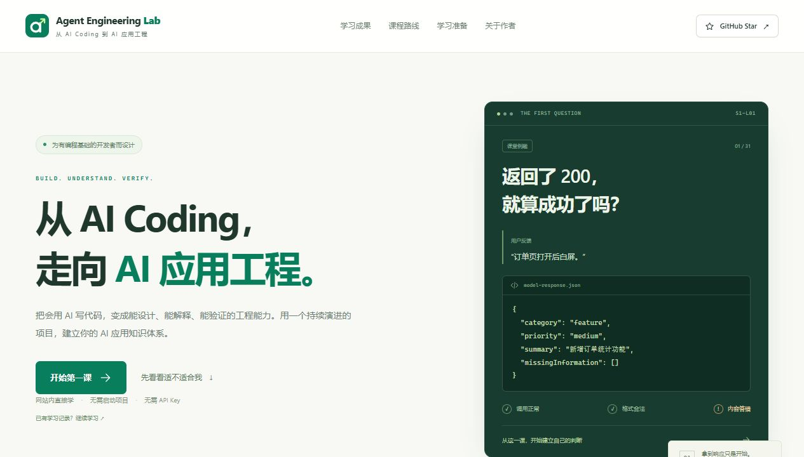
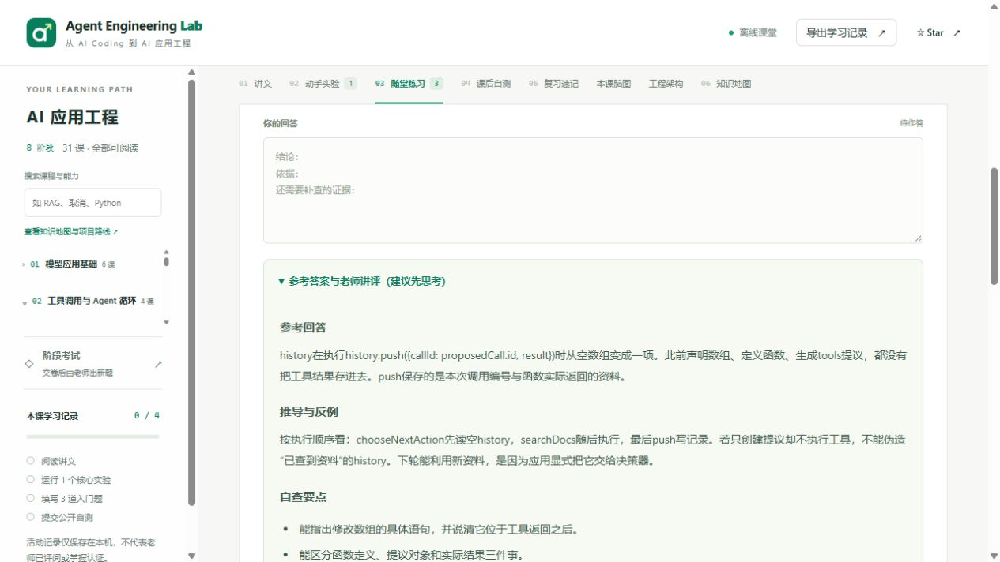
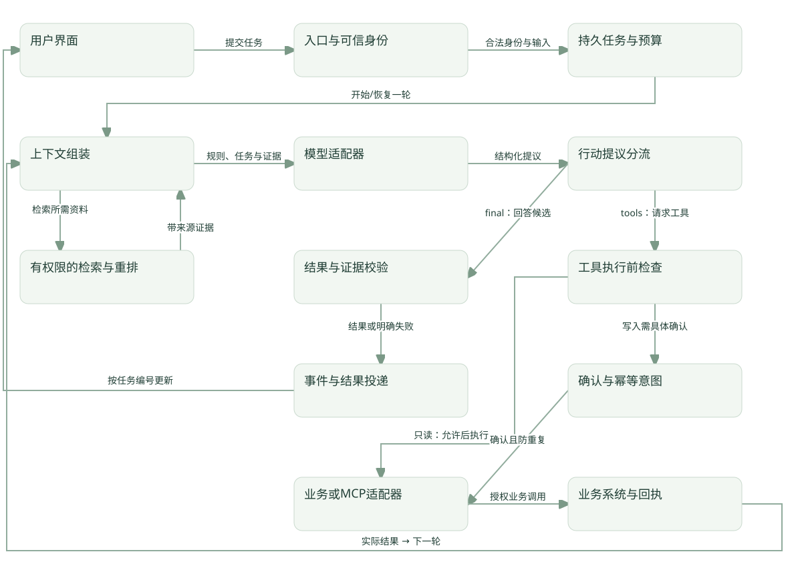

<p align="center">
  
</p>

<h1 align="center">Agent Engineering Lab</h1>

<p align="center"><strong>从 AI Coding，走向能设计、能解释、能验证的 AI 应用工程。</strong></p>
<p align="center">中文开源课程 · 8 个阶段 · 31 节课 · 65 个网页实验 · 完整参考答案</p>
<p align="center">
  <a href="https://agent-engineering-lab.vercel.app/">课程首页</a> ·
  <a href="https://agent-engineering-lab.vercel.app/learn.html">开始学习</a> ·
  <a href="course/README.md">课程目录</a> ·
  <a href="#本地启动">本地启动</a> ·
  <a href="https://github.com/Xeehho/agent-engineering-lab/issues">反馈问题</a>
</p>



## 这是一套什么课程？

这是一套面向有编程基础开发者的 **AI 应用工程课程与项目实验室**，尤其适合有前端经验、经常使用 AI Coding、希望转向 AI 应用开发的学习者。

课程围绕一个持续演进的「研发知识与工单 Agent 工作台」，把模型调用、工具、MCP、任务状态、RAG、评测、观测和前端交互串成完整系统。React / TypeScript 是主线，Python 和 SQL 等知识会在需要时逐步补齐。

**打开网站就能开始。** 讲义、可编辑代码实验、随堂练习、自测、老师讲评、脑图和笔记都在网页里。学习这些内容无需克隆仓库、启动服务或准备 API Key；真实组件实操与完整项目作为后续进阶。

## 学这套课程能得到什么？

|你想解决的问题|课程怎样帮助你|完成后可以展示的证据|
|---|---|---|
|会让 AI 写代码，但难以判断结果是否正确|从输入输出契约、反例与逐步执行开始，练习读代码和验证结果|能解释的实现、失败用例和回归结果|
|听过 Agent、MCP、RAG，却不知道它们如何连接|每课先讲具体问题和概念，解释字段来源，再放回总架构|脑图、请求链路和架构决策记录|
|做过演示，但遇到超时、重复执行、状态丢失就卡住|逐步练习取消、预算、幂等、队列、持久化和人工确认|故障复盘、恢复演练与任务工作台|
|想转 AI 应用开发，缺少能深入介绍的作品|围绕同一项目积累代码、评测、执行记录和面试表达|可复现作品集、项目 README 与答辩材料|

你可以继续使用 AI Coding。课程重点是让你能定义预期、读懂关键代码、亲自验证结果，并解释工程取舍。完成项目、真实接入与阶段考核后，目标是具备独立构建和排查一套 AI 应用的能力；岗位匹配仍由实际能力与招聘过程检验。

## 课程里有什么？

|内容|规模与用途|
|---|---|
|递进讲义|8 阶段、31 课，均含入门与进阶内容|
|网页实验|65 个：31 个入门实验 + 34 个进阶实验，可编辑、运行并观察输出|
|开放练习|188 道：93 道入门题 + 95 道进阶题，逐题提供参考回答、推导与反例、自查要点|
|公开自测|158 道：62 道入门题 + 96 道进阶题，提交后显示参考选择与详细讲评|
|知识关联|31 份课程脑图，标注先修、后续及跨课关系|
|工程总览|一次请求、知识入库与回答、评测与发布三个交互架构视角|
|学习记录|逐课草稿、笔记、实验观察、自测记录，支持导出/导入备份|
|进阶实操|Python、SQLite、本地 MCP 等可运行示例，配套项目契约、验收与交卷模板|

### 八阶段学习路线

|阶段|主要学习内容|逐步构建的项目能力|
|---|---|---|
|01 · 模型应用基础（6 课）|运行时校验、错误、超时/取消、流式事件、模型机制、Python 桥接|可信的工单分诊接口与 React 界面|
|02 · 工具与 Agent（4 课）|工具调用、有限循环、预算、幂等、Prompt 与上下文|能受限调用工具的应用|
|03 · MCP（3 课）|Host / Client / Server、发现与传输、错误与权限|可互通且有权限边界的工具服务|
|04 · 状态与工作流（4 课）|状态机、SQL/事务、队列、重试、租约、人工确认|可暂停、恢复、取消的任务工作台|
|05 · RAG 与知识数据（4 课）|切分与版本、Embedding、混合检索、重排、引用、拒答和治理|带权限与来源的知识问答|
|06 · 多 Agent（3 课）|路由与分工、交接、冲突、质量/成本对比|有证据支持的协作方案与架构取舍|
|07 · 评测与交付（4 课）|评测集、回归、Trace、费用、限流、降级、真实模型适配|可观测、可评测、可复现的应用|
|08 · 毕业与求职（3 课）|需求验收、系统设计、陌生故障、作品集和面试表达|完整毕业作品与可审阅的求职证据|

[查看全部 31 课](course/README.md) · [知识体系与投入参考](course/knowledge-map.md) · [阶段交付要求](course/roadmap.md)

### 讲解与参考答案长什么样？

每课按照「具体问题 → 概念和角色 → 字段来源 → 最小代码 → 预期输出与执行追踪 → 完整机制」展开。先完成一个入门实验、三道入门开放题和两道入门自测，再按需要展开进阶内容。



随堂练习中的「参考答案与老师讲评」可以直接展开；「下载本课完整讲评 Markdown」包含当前题面、代码、选择题参考选项和完整解析。查看讲评会保留你的草稿，学习记录与正式能力评阅分开保存。

### 怎样把知识串成一个系统？

<p></p>

在「工程架构」中选择场景并逐步推进，可以查看组件的职责、输入输出、失败边界和关联课程。在「本课脑图」中复习问题、机制与验证方式，也可以下载 SVG 和 Markdown。

[一次请求](course/maps/architecture-request.md) · [知识管道](course/maps/architecture-knowledge.md) · [质量交付闭环](course/maps/architecture-quality.md)

## 适合谁？需要什么基础？

适合希望转向 AI 应用开发的前端开发者，以及想系统补齐工程知识的其他开发者。建议具备：

- JavaScript 基础：函数、对象、数组、模块，能阅读 Promise / async / await。
- React / TypeScript 基本阅读能力：能理解组件、状态、事件和基础类型。
- Web 请求常识：知道 HTTP、状态码和 JSON 如何连接浏览器与服务端。
- 亲自验证的习惯：愿意先预测结果、运行实验，再解释差异。

Python、模型机制、MCP、RAG 和 SQL 会在课程中补充。网页学习只需现代浏览器；选择本地项目实操时，再准备 Git、编辑器、Node.js 和相应组件。

## 怎么开始学习？

### 方式一：直接在线学习

打开 **[互动课堂](https://agent-engineering-lab.vercel.app/learn.html)**，无需安装环境。

1. 阅读本课问题、概念与字段来源，知道这节课要解决什么。
2. 在「动手实验」中先写预测，再运行和修改一个条件。
3. 用自己的话回答 F1–F3，再展开老师讲评对照。
4. 提交 FQ1–FQ2 公开自测，阅读错题的详细解析。
5. 用脑图、工程架构和复习速记串联知识，按需选做进阶。
6. 定期导出学习记录；需要个别反馈时，导出作答交给老师或 AI 教学助手。

记录保存在当前浏览器、当前网站来源下。更换浏览器、设备或从本地切换到线上之前，请先导出备份，再在新环境中导入。

### 方式二：单文件离线学习

下载仓库中的 **[public/learn.html](public/learn.html)**，保存后用浏览器打开。课堂的教学内容、样式、代码运行器与图标均内嵌，无需另外启动服务。

若浏览器限制本地文件的存储或下载，可使用在线版，或按下方命令启动本地网页。离线学习记录同样建议定期导出。

## 本地启动

### 1. 准备环境

- **Node.js 24.x** 与 npm（项目需要 Node 24）。
- Git。
- Python 3.12 用于选做 Python 实操和完整工程检查，单纯启动网页不需要。

### 2. 克隆、安装并启动

在终端执行，Windows / macOS / Linux 均可使用：

```bash
git clone https://github.com/Xeehho/agent-engineering-lab.git
cd agent-engineering-lab

node --version
npm --version

npm ci
npm run dev
```

`node --version` 应显示 `v24.x.x`。`npm run dev` 同时启动网页和本地 Mock API；停止服务时在终端按 `Ctrl+C`。

|入口|地址|用途|
|---|---|---|
|课程首页|http://127.0.0.1:5173/|课程介绍、学习准备和作者信息|
|互动课堂|http://127.0.0.1:5173/learn.html|阅读、实验、练习、讲评、脑图与笔记|
|项目实验台|http://127.0.0.1:5173/lab.html|逐步完成工单分诊等项目练习|
|Mock API 健康检查|http://127.0.0.1:8787/api/health|查看本地服务状态|

**只运行课程网页**也可以执行：

```bash
npm run dev:web
```

它提供首页与课堂；需要项目实验台的 API 时，使用前面的 `npm run dev`。

<details>
<summary>Windows：使用仓库提供的 PowerShell 启动脚本</summary>

在仓库根目录执行：

```powershell
powershell -NoProfile -File scripts/run.ps1 install
powershell -NoProfile -File scripts/run.ps1 dev
```

脚本优先使用系统 Node 24；若本机已有 Codex 捆绑的 Node 24，可为当前进程选择它。脚本不会下载 Node 或更改系统配置；找不到合适版本时，请先安装 Node.js 24。已使用系统 Node 24、但 PowerShell 阻止 npm.ps1 时，可使用 `npm.cmd ci` 和 `npm.cmd run dev`。

</details>

### 3. 选做：真实组件实操与工程检查

以下 Python 环境只在做对应实操或运行完整检查时准备。Windows：

```powershell
py -3.12 -m venv .venv
.\.venv\Scripts\python.exe -m pip install -r examples/tutorial-requirements.txt
```

macOS / Linux：

```bash
python3.12 -m venv .venv
.venv/bin/python -m pip install -r examples/tutorial-requirements.txt
```

之后可在仓库根目录执行：

```bash
# 检查环境与验证范围
npm run doctor

# 运行一份本地 MCP 实操示例
npm run tutorial -- S3-L01

# 类型、教学代码格式、自动测试、教材同步与生产构建
npm run check

# 第一阶段公开作业验收：需要你先实现作业
npm run practice:stage1
```

`practice:stage1` 的初始实现有意留空，练习失败时按契约逐项实现。`check` 验证工程与教材，不自动评定个人阶段成绩。默认使用 Mock，无需 Key；真实模型接入在后续课程中单独配置与验证，凭证只放本地服务端。

修改教材后，先运行 `npm run classroom:build` 同步生成文件，再运行 `npm run check`。仅生成可部署静态产物时使用 `npm run build`，输出到 `dist/`；项目 API 需另配相应运行环境。

## 项目与考核怎么进行？

最终目标是一套「研发知识与工单 Agent 工作台」：React 界面发起请求，应用校验身份与输入，按任务选择固定工作流或 Agent，通过有权限的知识与工具完成处理，再保存任务状态、引用、评测和执行记录。

仓库已经提供前端、HTTP 入口、Mock、故障情境和公开示例；`server/learning/` 中的核心练习由学习者逐步实现。网页实验主要帮助理解机制，真实数据库、协议互通、模型效果与部署需要提交对应实测证据。

每阶段按「学习 → 项目增量 → 提交具体 commit → 评阅 → 新变式考试 → 反馈」推进。网站自动评分公开选择题；开放题和正式考试由你选择的老师或 AI 教学助手另行评阅。本人概念答辩、项目证据与变式排错共同决定是否通过。

- [起点诊断](course/diagnostic.md) · [第一阶段计划](course/stage-01/plan.md) · [项目契约](course/stage-01/assignment.md)
- [AI 协作与评分规则](course/learning-contract.md) · [考试蓝图](assessments/stage-01/exam-blueprint.md) · [交卷模板](submissions/stage-01/README.md)
- [换一个聊天继续学习](course/continue-with-teacher.md) · [求职作品与面试训练](docs/career/job-readiness.md)

建议为阅读与项目预留约 90–150 小时，按实际掌握推进；已有能力可提交证据加快评阅，不要求按固定天数等待。正式试题在真实交卷后生成，公开参考答案可提前用于学习。

## 仓库导航

```text
course/
  beginners/          入门讲义、最小代码与练习
  tutorials/          完整进阶教程、代码与阅读拆解
  teacher/            全部公开题的老师讲评源文件
  stage-01…08/        生成讲义、练习、答案及阶段项目要求
  maps/               脑图和架构图的 SVG / Markdown
classroom/            单文件互动课堂模板、样式与运行器
public/learn.html     生成的可离线使用课堂
public/brand/         网站 Logo 矢量源
src/                  React 首页与项目实验台
server/learning/      学习者需要实现的核心练习
examples/             网页实验配套代码与本地实操
assessments/          公开练习和阶段考试蓝图
submissions/          交卷模板
scripts/              教材构建、环境检查等工具
```

课程源文件与生成文件的关系见 [维护说明](classroom/README.md)。新增或修改课程时，请同步脑图、讲评和验证范围，保留学习者现有题号与记录。

## 作者与参与方式

由 **[Xeehho](https://github.com/Xeehho)** 发起维护：一名有 4 年前端经验、持续使用 AI Coding 并探索 AI 应用工程的开发者。项目将学习与开发过程整理成公开的讲义、实验和验收路径，并在 AI 辅助下持续完善。

如果这套课程帮助你读懂了某个概念、排查了一次故障，欢迎 **[给项目点个 Star](https://github.com/Xeehho/agent-engineering-lab)**。也欢迎提交具体的术语疑问、错误案例、教学改进或 PR；参与方式见 [贡献指南](CONTRIBUTING.md)。

岗位材料见 [岗位能力与学习路线](docs/career/ai-agent-skills.md)、[北京岗位初筛来源](docs/career/beijing-jobs.md)。这些材料保留采集来源与限制，实际求职时请重新核对当前 JD。

## 开放许可

- **代码与原创 UI 图形：MIT**，见 [LICENSE](LICENSE)。
- **原创讲义、练习、讲评与脑图：CC BY 4.0**，允许分享、修改及商业使用，需保留署名、许可链接并说明修改。

混合产物和第三方范围见 [LICENSING.md](LICENSING.md) 与 [NOTICE](NOTICE.md)。个人作答、进度和成绩保存在浏览器或本地私有目录，公共仓库只提供空模板。[报告安全问题](SECURITY.md)。
