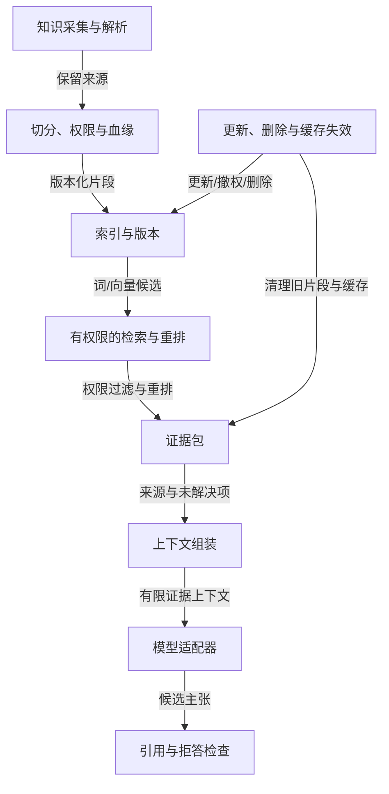

# 知识管道：从原文到可核验引用

检索与生成前有数据工程，回答后有主张核验；更新、撤权和删除沿整条管道传播。

## 知识采集与解析

输入：经授权的原文及来源信息

输出：清理后的正文、标题与解析异常

边界：避免静默丢表格和条件；记录来源、获取时间与处理版本。

## 切分、权限与血缘

输入：原文、有效版本和访问范围

输出：可追溯到原文的片段

边界：片段权限继承要明确，旧版本与删除应传播到索引及缓存。

## 索引与版本

输入：片段、关键词/向量表示及模型配置

输出：可查询的版本化索引

边界：embedding维度、度量与模型版本配套；发布索引也需回滚与删除规则。

## 有权限的检索与重排

输入：当前问题、可信权限范围和索引版本

输出：带来源版本的候选证据包

边界：先过滤权限再暴露；相似度不是正确率，没证据就追问或拒答。

## 证据包

输入：已过滤并排序的片段

输出：来源、版本、主张依据及未解决项

边界：不要把相关候选直接改名为已证实事实；冲突和过期需要保留。

## 上下文组装

输入：可信规则、任务、历史工具结果与可读证据

输出：本轮发给模型的有限材料

边界：应用持久记录不等于本轮上下文；资料中的指令没有执行权。

## 模型适配器

输入：本轮上下文、输出契约、期限和取消信号

输出：内部格式的回答、工具提议或明确错误

边界：外部SDK格式应转换；截断、拒绝、工具提议和最终成功分开。

## 引用与拒答检查

输入：候选回答和逐主张证据关系

输出：支持充分的回答或明确不足说明

边界：链接存在不证明支持结论；人工校准语义判断，避免越权泄漏。

## 更新、删除与缓存失效

输入：新版本、撤权或删除事件

输出：更新中的状态与已传播范围

边界：缓存键考虑权限与资料版本；不能删除原文后继续返回旧答案。

Xeehho · CC BY 4.0
