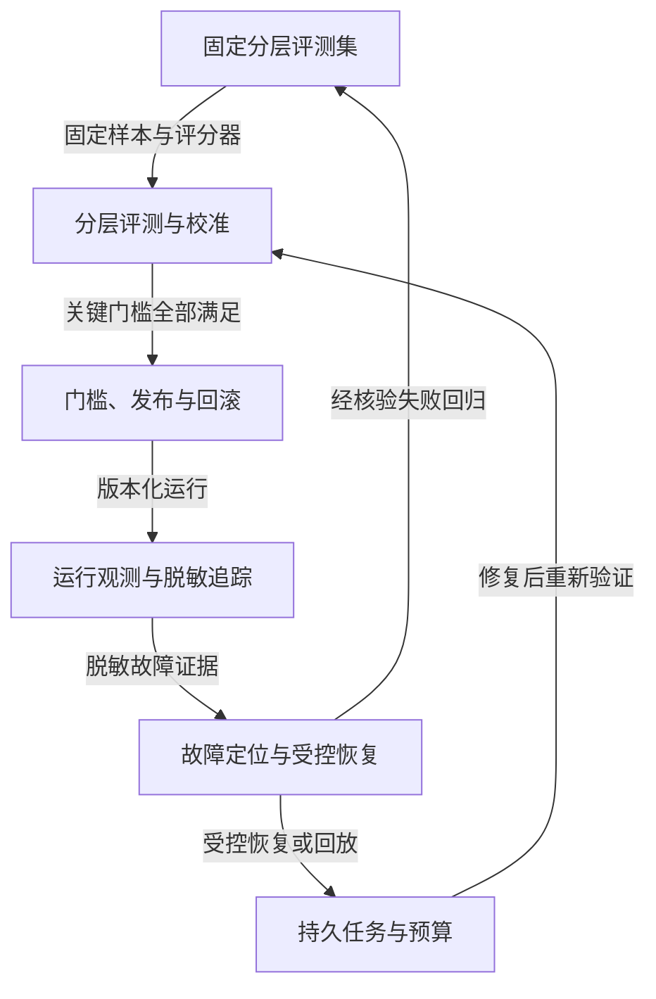

# 质量闭环：评测、发布、观测、改进

离线指标决定是否允许发布，在线观测发现真实故障；经核验的失败样本回到开发与回归集。

## 固定分层评测集

输入：真实授权样本或合成案例、标注与切分

输出：开发集、保留测试集及关键失败案例

边界：防止测试泄漏；标注版本和采样范围可追溯。

## 分层评测与校准

输入：版本化候选系统、数据集和评分器

输出：逐案例、逐层与关键错误的结果

边界：失败请求进入分母，失败费用进入成本；平均分不抵消越权。

## 门槛、发布与回滚

输入：评测证据、容量、配置和迁移方案

输出：可追溯的发布版本或阻断原因

边界：启动成功不等于可用；回滚应用前考虑数据兼容与副作用。

## 运行观测与脱敏追踪

输入：trace、日志、指标、usage和版本

输出：可关联的故障、成本与延迟证据

边界：未知用量保留未知；日志不要记录密钥和无必要的个人内容。

## 故障定位与受控恢复

输入：症状、时间线、失败记录与操作回执

输出：可证伪假设、最小修复与恢复决策

边界：结果未知先核对；修复后复跑相关回归，别把重放变成重复写入。

## 持久任务与预算

输入：已验证任务、期限、尝试与取消意图

输出：状态版本、有限执行资格与恢复记录

边界：内存循环不是持久任务；租约与取消都需要执行方配合。

Xeehho · CC BY 4.0
