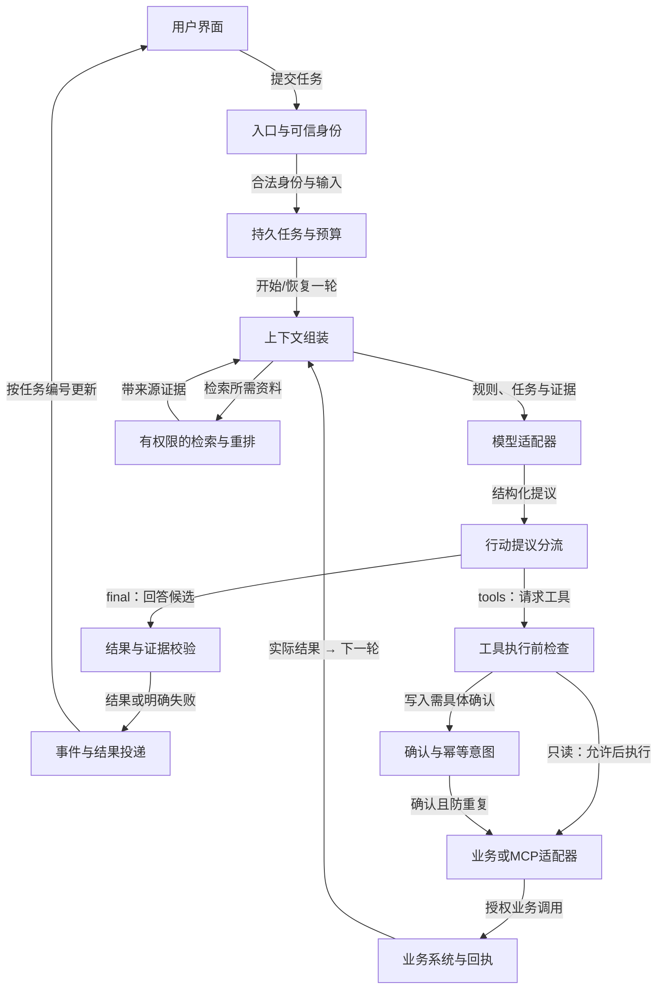

# 一次请求：从输入到回答或工具

看主线，再看两个分支：回答走校验；工具走执行检查，结果回到下一轮上下文。持久任务负责全程预算、取消和恢复。

## 用户界面

输入：用户任务、当前任务快照与事件

输出：请求、取消或批准的明确意图

边界：界面不掌握模型密钥；按钮状态不能替代服务端授权。

## 入口与可信身份

输入：HTTP请求及已验证的身份凭据

输出：合法输入、租户与调用者上下文

边界：请求体和模型参数里的tenantId不能成为可信身份。

## 持久任务与预算

输入：已验证任务、期限、尝试与取消意图

输出：状态版本、有限执行资格与恢复记录

边界：内存循环不是持久任务；租约与取消都需要执行方配合。

## 上下文组装

输入：可信规则、任务、历史工具结果与可读证据

输出：本轮发给模型的有限材料

边界：应用持久记录不等于本轮上下文；资料中的指令没有执行权。

## 模型适配器

输入：本轮上下文、输出契约、期限和取消信号

输出：内部格式的回答、工具提议或明确错误

边界：外部SDK格式应转换；截断、拒绝、工具提议和最终成功分开。

## 行动提议分流

输入：模型适配器转换后的候选决定

输出：回答候选或待验证工具调用

边界：模型的“已执行”文字不能作为执行证据；提议尚未获得权限。

## 有权限的检索与重排

输入：当前问题、可信权限范围和索引版本

输出：带来源版本的候选证据包

边界：先过滤权限再暴露；相似度不是正确率，没证据就追问或拒答。

## 结果与证据校验

输入：最终候选、来源和业务约束

输出：可展示结果、拒答或明确失败

边界：结构正确不代表事实正确；逐条主张核对引用和业务规则。

## 工具执行前检查

输入：工具名称、参数、当前身份与预算

输出：允许的只读调用或待批准写入

边界：检查白名单、参数、资源授权与额度，外部资料不能授予权限。

## 事件与结果投递

输入：有任务编号、版本和终态的服务端结果

输出：可去重、可关联的界面更新

边界：网络chunk不是业务事件；旧请求和终态后的增量不能污染UI。

## 确认与幂等意图

输入：具体操作、内容版本、批准者与操作编号

输出：可执行意图或等待/拒绝/待核对

边界：批准绑定内容；写操作超时可能已执行，应查回执而非盲重发。

## 业务或MCP适配器

输入：通过检查的调用与可信执行上下文

输出：真实业务结果或分类错误

边界：可直接调用函数或API；需要互操作时才经MCP Client/Server，不是所有工具都必须MCP。

## 业务系统与回执

输入：授权后的读写操作和幂等编号

输出：资料、写入回执或结果未知状态

边界：数据库事务不自动覆盖外部邮件；记录副作用状态并提供恢复路径。

Xeehho · CC BY 4.0
