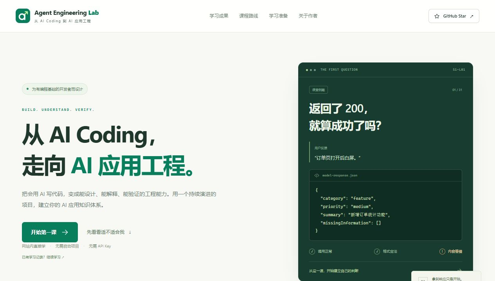
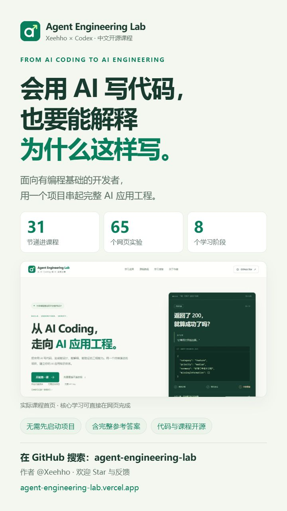
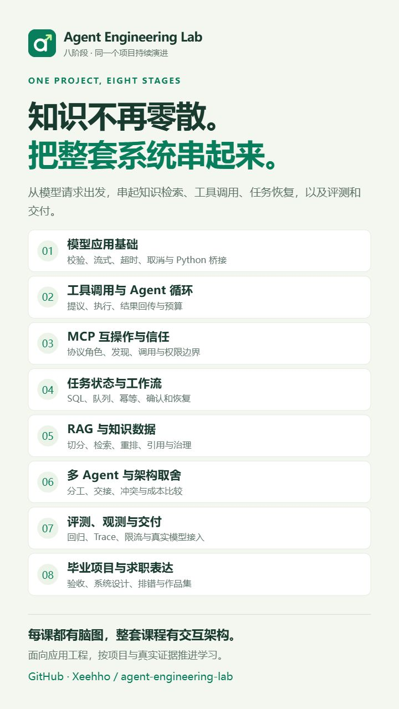
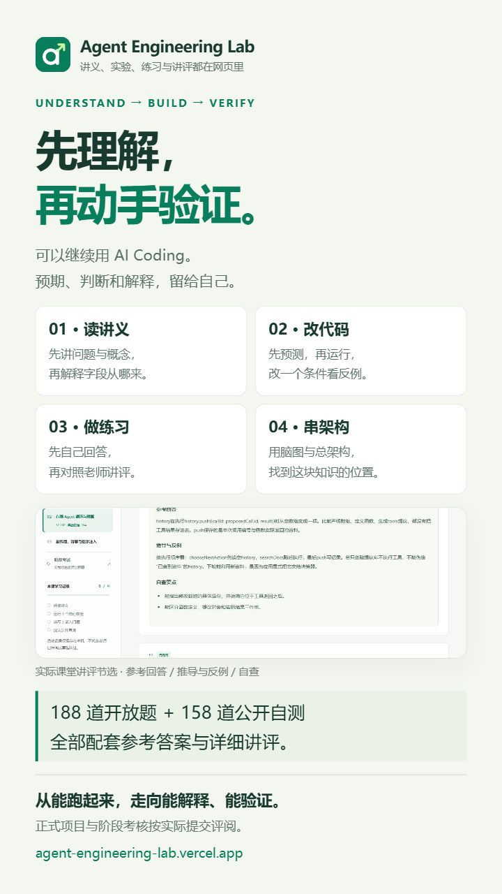

# 项目分享素材

为X/Twitter和抖音准备的图片与可修改文案，基于2026-11-06的实际课程内容。所有图片均不显示滚动条，没有学习者真实作答、成绩、密钥或个人笔记。

**[可直接复制的发布文案](launch-copy.zh-CN.md)** · [全部素材总览](images/overview.jpg) · [在线课程](https://agent-engineering-lab.vercel.app/) · [GitHub仓库](https://github.com/Xeehho/agent-engineering-lab)

## X / Twitter横版素材

|文件|像素|内容与建议顺序|
|---|---|---|
|[x-01-home.jpg](images/x-01-home.jpg)|1265 × 720|真实课程首页，适合作为第一张|
|[x-02-teacher.jpg](images/x-02-teacher.jpg)|1280 × 960|真实公开题讲评，展示参考回答、推导与反例、自查|
|[x-03-agent-map.jpg](images/x-03-agent-map.jpg)|1280 × 720|课程原始SVG脑图截图：Agent循环|
|[x-04-architecture.jpg](images/x-04-architecture.jpg)|1280 × 720|课程原始SVG架构图截图：请求、模型、工具和状态|

## 抖音竖版分享图

三张均为 **720 × 1280（9:16）**。它们是专门制作的宣传排版图，封面和学习方式图内嵌实际页面截图；八阶段图依据当前课程目录整理，不冒充网站新增页面。

|封面|八阶段路线|学习方式|
|---|---|---|
|[打开原图](images/douyin-01-cover.jpg)|[打开原图](images/douyin-02-roadmap.jpg)|[打开原图](images/douyin-03-learning.jpg)|
||||

建议按封面→路线→学习方式的顺序发图文，或配合文案里的口播稿做录屏视频。标题、正文和话题均可按自己的表达调整。

## 可复用排版源

[posters.html](posters.html)保存竖图HTML/CSS源，可在克隆仓库后用浏览器预览：`#cover`、`#roadmap`、`#learning`分别对应三张图。页面引用本目录图片与仓库Logo；720×1280视口下可完整截图。它是分享素材源，不是课程应用页面。

## 后续截图约定

- 展示内容取自真实课程，拍摄前确认题目、数量与功能描述仍准确。
- 排除页面外层、课程目录、标签和代码区域的所有可见滚动条。
- 截图时可在独立预览页临时隐藏滚动条，截图后关闭预览，保留网站正常滚动功能。
- 使用默认状态或独立来源的合成记录，避免展示真实个人学习数据。
- 宣传排版与实际界面截图分别标明；不添加虚构学员评价、效果指标、就业或薪资承诺。

原创文案、课程截图与宣传图文按项目CC BY 4.0署名要求分享；可复用HTML/CSS和原创UI标识为MIT。建议署名：Agent Engineering Lab — Xeehho，附仓库链接。范围见[许可说明](../../LICENSING.md)。
